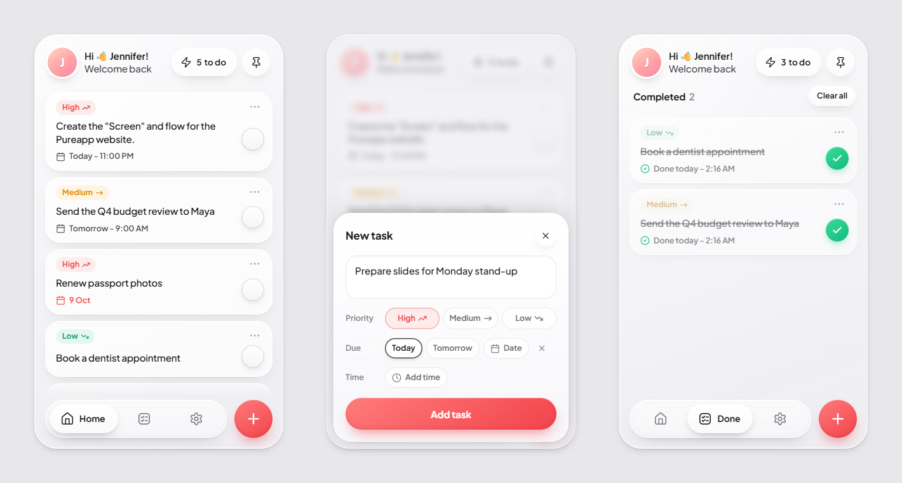

# Dooo

A glassy little to-do widget for your Windows desktop



## Features

- **Glass design.** Frosted, translucent cards, soft shadows and rounded corners. No title bar and no taskbar button: it just sits on your desktop.
- **Opens when you sign in to Windows.** On by default, and you can turn it off any time. It opens without stealing focus.
- **Keep on top.** Pin Dooo above your other windows with the pin button.
- **Drag and drop.**
  - Reorder tasks by dragging them.
  - Drag a task onto **Done** to complete it, and drag it from the Done view back onto **Home** to restore it.
  - Drop text from any app onto the widget and each line becomes a task.
- **Priorities.** High, Medium or Low, shown as a colored tag on every task.
- **Due dates and times.** Pick Today, Tomorrow or any date, with an optional time. Overdue tasks turn red.
- **Undo.** A quick Undo button appears after you complete, restore or delete a task.
- **Tray icon.** Hide Dooo out of the way and bring it back with one click.
- **Remembers its position and size.** Dooo comes back where you left it.
- **Your data stays local.** No account and no sync: tasks and settings are saved on your PC, and Dooo blocks web requests.

## Install

Build the installer (requirements are under [Development](#development)):

```
npm install
npm run dist
```

1. The installer lands at `dist\Dooo-Setup-1.0.0.exe`.
2. Double-click it. It installs for the current user without admin rights, creates Start-menu and desktop shortcuts, and launches Dooo.
3. The installer is unsigned, so Windows SmartScreen may say "Windows protected your PC". Click **More info**, then **Run anyway**.

To uninstall, use Settings > Apps. That also removes the startup entry; your tasks are kept (see [Your data](#your-data)).

## Using Dooo

### Tasks

- **Add:** click the **+** button or press `Ctrl+N`. Type the task, optionally set a priority, a due date (Today, Tomorrow or Date) and a time, then press `Enter` or click **Add task**. New tasks go to the top of the list.
- **Complete:** click the circle on the right of a task. It moves to **Done**.
- **Edit:** click a task to reopen it in the sheet.
- **The ··· menu:** the three dots on a task offer Edit, a quick Priority switch and Delete. On a completed task they offer Restore and Delete.
- **Undo:** after you complete, restore or delete a task, clear completed tasks, or add tasks by dropping text, a toast with an **Undo** button shows for a few seconds. `Ctrl+Z` does the same while it is showing.
- **Done:** the middle tab lists finished tasks, newest first. Restore one with its green check or its ··· menu, or empty the list with **Clear all**.

### Drag and drop

- **Reorder:** press on a task (not on its buttons) and drag it up or down the list.
- **Complete:** drag a task onto **Done** in the bottom bar.
- **Restore:** in the Done view, drag a task onto **Home**. It goes back to the top of your list.
- **Add from other apps:** select text anywhere, drag it onto Dooo and drop it. Each non-empty line becomes a Medium-priority task with no due date (up to 20 lines per drop; leading bullets, numbers and checkboxes are removed). Dropped files are ignored.
- `Esc` cancels a drag in progress.

### The widget and the tray

- **Move:** drag the header.
- **Resize:** drag the grip in the bottom-right corner (it appears when you hover over Dooo). The smallest size is 360 x 480; the widest is 760 px, and it can be as tall as your screen's usable area.
- **Hide:** click the small **x** in the top-right corner (it appears on hover). Dooo keeps running in the tray. `Alt+F4` does the same: closing the window only hides it.
- **Get it back:** click the tray icon (it may be behind the ^ arrow in the notification area) or launch Dooo again from the Start menu or desktop shortcut. There is only ever one Dooo, so launching it again just brings the existing widget back.
- **Tray menu:** right-click the tray icon for **Show Dooo**, **Keep on top** and **Launch at startup** (both checkboxes), and **Quit Dooo**.

### Settings

Open the gear on the bottom bar:

- **Your name** (used in the greeting) and a **profile photo** (cropped to a small square and stored with your settings).
- **Keep on top.** The same switch as the pin button in the header.
- **Launch at startup.** Opens Dooo when you sign in to Windows.
- **Clear completed.** Removes all finished tasks (with Undo).
- **Quit.** Closes Dooo completely.

## Keyboard shortcuts

These work while Dooo has focus. The task shortcuts act on the task that has keyboard focus (press `Tab` to reach one).

| Keys | What it does |
| --- | --- |
| `Ctrl+N` | New task (opens the add sheet) |
| `Enter` | In the add/edit sheet: save. On a focused task: edit it |
| `Esc` | Close the open ··· menu or the sheet; cancel a drag |
| `Ctrl+Z` | Undo the last action while the Undo toast is showing (not while typing in a field) |
| `Space` | On a focused task: complete it (or restore it in Done) |
| `Delete` | On a focused task: delete it (with Undo) |
| `Up` / `Down` | On a focused task: move focus to the previous or next task |
| `Alt+Up` / `Alt+Down` | On a focused task in Home: move it up or down the list |

## Your data

- **Location:** `%APPDATA%\Dooo\` (paste it into the Explorer address bar). It holds:
  - `tasks.json`: your tasks
  - `settings.json`: your name, photo, Keep on top and Launch at startup
  - `window-state.json`: the window position and size
- Writes are atomic, and each file keeps a `.bak` copy of its previous good version. If a file is ever damaged, Dooo restores it from the backup.
- **Development runs** (`npm start`) use `%APPDATA%\Dooo-dev\` instead, so they never touch your real tasks.
- **Uninstalling keeps your data.** To wipe it, quit Dooo and delete the folder.

## Development

Requirements: Windows 10/11 and Node.js 20+ (built with Node 24).

| Command | What it does |
| --- | --- |
| `npm install` | Installs the dependencies |
| `npm start` | Runs Dooo from source |
| `npm run test:unit` | Runs quick checks of the window-geometry and startup-entry code in plain Node (no window opens) |
| `npm run test:e2e` | Runs the end-to-end test (see below) |
| `npm run pack` | Builds the unpacked app in `dist\win-unpacked\`, without an installer |
| `npm run dist` | Builds the installer, `dist\Dooo-Setup-1.0.0.exe` |

**End-to-end test.** `npm run test:e2e` launches the real app with a throwaway data folder (and Windows startup left alone) and drives it with Playwright: adding, reordering, completing and restoring tasks, dropping text, the Settings switches, the click-through safety net, resizing, and a close-and-relaunch check that everything was saved. Screenshots go to `test-results\`. A Dooo window opens while it runs, and the test exits with 0 on success.

**Environment variables**

- `DOOO_USER_DATA_DIR=<folder>`: keep all data in `<folder>` instead of `%APPDATA%\Dooo` (or `Dooo-dev`). Handy for trying things without touching your real tasks.
- `DOOO_DISABLE_AUTOSTART=1`: never touch the Windows startup entry. Only packaged builds ever do, so `npm start` is already safe.

Careful when you run the result of `npm run pack` (`dist\win-unpacked\Dooo.exe`): it is a packaged app, so unlike `npm start` it uses `%APPDATA%\Dooo` (your real data, if Dooo is installed) and registers launch at startup. Set both variables first.

In `npm start` runs, `F12` (or `Ctrl+Shift+I`) opens DevTools and `Ctrl+R` reloads the page.

## Project layout

| Path | What is in it |
| --- | --- |
| `src/main/` | The Electron main process: the widget window, tray icon, task and settings storage, launch at startup |
| `src/preload/` | The sandboxed preload script that gives the page its small `window.dooo` API |
| `src/renderer/` | The UI: `index.html`, `css/`, `js/` and the bundled font |
| `src/assets/` | The app and tray icons used at run time |
| `build/` | Installer resources: the app icon and the NSIS script that cleans up the startup entry on uninstall |
| `tests/` | The end-to-end test (`e2e.js`) and the unit checks (`unit.js`) |
| `docs/` | The README screenshot |

## Credits

- [Electron](https://www.electronjs.org) and [electron-builder](https://www.electron.build)
- The [Plus Jakarta Sans](https://github.com/tokotype/PlusJakartaSans) font, under the SIL Open Font License 1.1 (see `src/renderer/vendor/fonts/OFL.txt`)
- [Lucide](https://lucide.dev)-style icons (ISC License), a few of them drawn by hand in the same style
